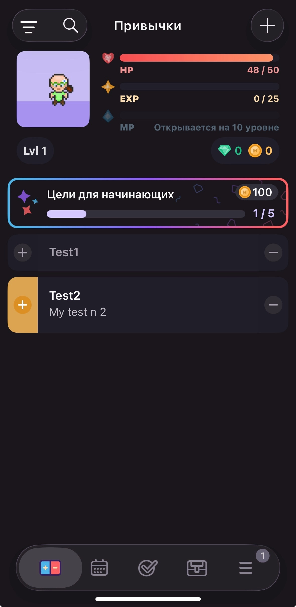
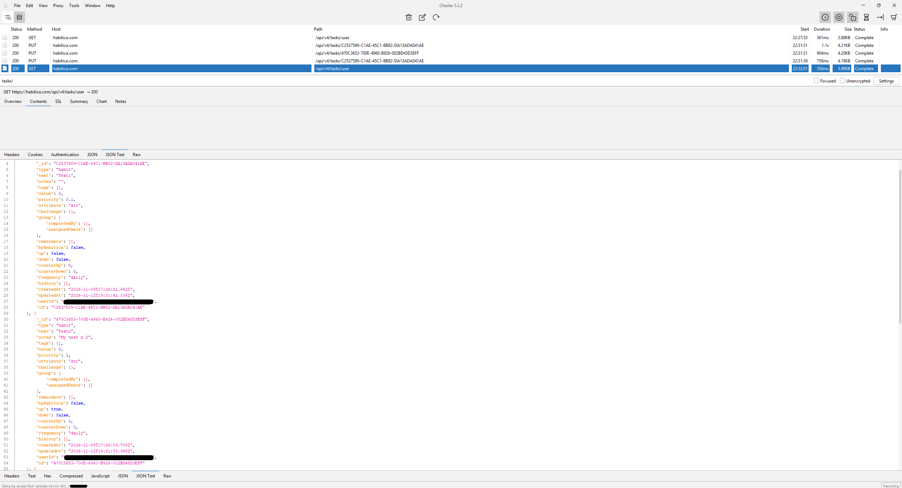

# Перехват трафика мобильного приложения: iPhone + Charles Proxy

Небольшой кейс: подключил iPhone к ПК через Charles Proxy и разобрал
HTTPS-запросы приложения Habitica к его API.

## Что сделано
- Настроен Charles Proxy на ПК, iPhone подключён через ручной прокси в настройках Wi-Fi
- Установлен и включён root-сертификат Charles (Доверие сертификатов)
- Включён SSL Proxying для расшифровки HTTPS
- Проанализированы запросы приложения к API

## Результат

### 1. Действие в приложении на iPhone
Список привычек Test1 и Test2 в приложении Habitica.

### 2. Перехваченные запросы в Charles
GET `/api/v4/tasks/user` и PUT `/api/v4/tasks/{id}`, статус 200, тело ответа в JSON.

## Что удалось увидеть
- При открытии или обновлении списка приложение делает `GET /api/v4/tasks/user`.
- При изменении задачи отправляется `PUT /api/v4/tasks/{id}`.
- В ответе приходит JSON с полями `text`, `notes`, `type`, `priority`,
  `frequency`, `createdAt`, `updatedAt` и другими. Названия Test1 и Test2
  из приложения совпадают с полем `text` в ответе.

## Проблемы и решения
- HTTPS не расшифровывался, пока не был включён переключатель доверия
  сертификату в настройках iPhone.
- Charles блокировал устройство с сообщением «Denying access from address
  not on ACL», пока я не разрешил доступ для телефона.

## Чему научился
- Как работает HTTP(S)-прокси и зачем он нужен при отладке
- Как читать запросы и ответы REST API мобильных приложений

> Персональные идентификаторы (userId) на скриншотах скрыты.
